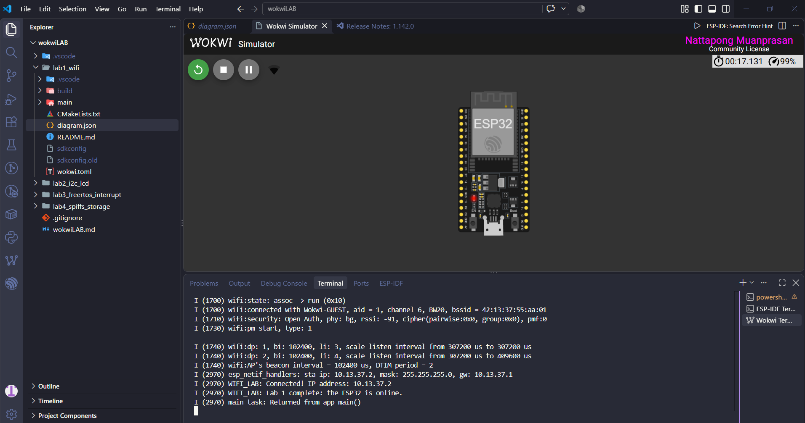
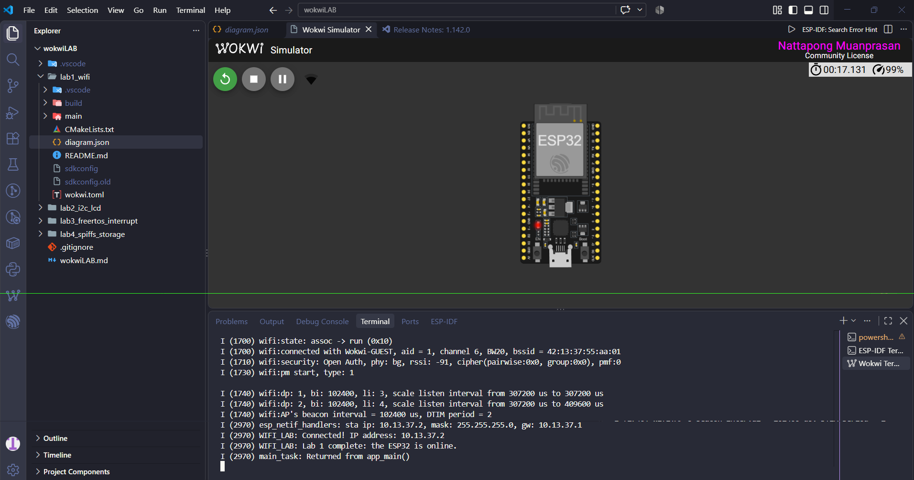
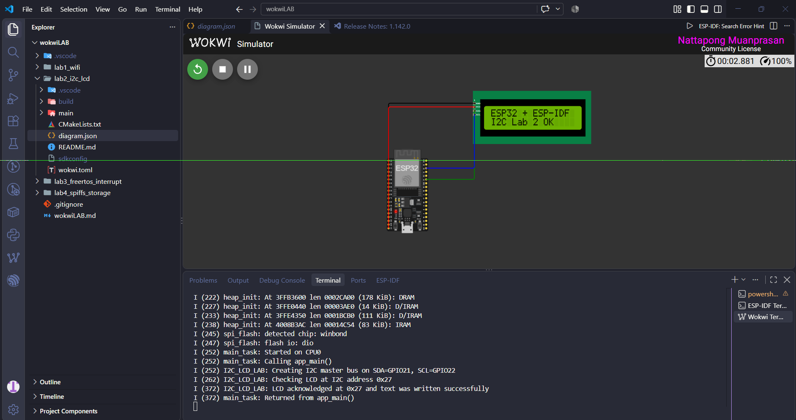
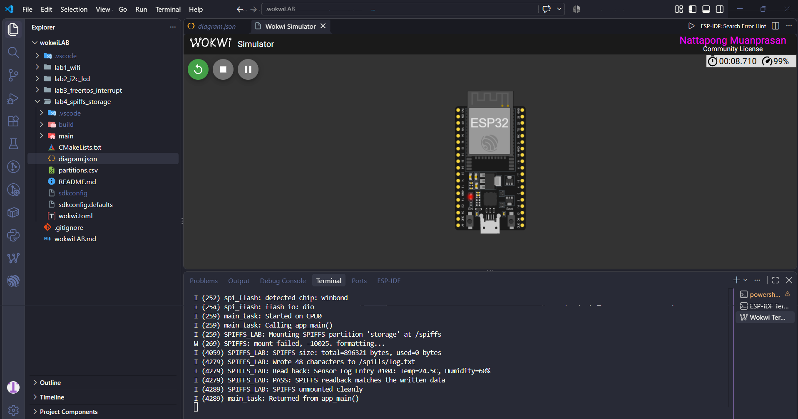

# สรุปการทดลอง ESP32 ด้วย ESP-IDF และ Wokwi

รายงานนี้เป็นการสรุปการทดลองใช้งาน ESP32 ผ่าน ESP-IDF และจำลองวงจรด้วย Wokwi ทั้งหมด 4 งาน โดยแต่ละงานจะเน้นคนละส่วน ได้แก่ การเชื่อมต่อ Wi-Fi, การสื่อสารผ่าน I2C, การใช้งาน Interrupt ร่วมกับ FreeRTOS และการจัดเก็บข้อมูลลง Flash ด้วย SPIFFS

ระหว่างทำมีทั้งส่วนที่ทำงานได้ตามเป้าหมายและปัญหาจากการตั้งค่าโปรเจกต์ โดยเฉพาะเรื่องเวอร์ชันของ ESP-IDF, การ build และขนาด partition แต่หลังจากแก้ค่าต่าง ๆ แล้วก็เข้าใจลำดับการทำงานของระบบมากขึ้น

## งานที่ 1: เชื่อมต่อ Wi-Fi

งานแรกเป็นการตั้งค่า ESP32 ให้ทำงานในโหมด Station หรือ STA แล้วเชื่อมต่อกับ Wi-Fi จำลองชื่อ `Wokwi-GUEST` ซึ่งไม่ต้องใส่รหัสผ่าน

ขั้นตอนหลักของโปรแกรมคือเริ่มต้น NVS ก่อน จากนั้นเตรียมระบบ network interface, สร้าง event loop, ตั้งค่า Wi-Fi driver และรอเหตุการณ์ที่ ESP32 ได้รับ IP Address โดยใช้ FreeRTOS Event Group

ผลที่ต้องสังเกตจาก Serial Monitor คือข้อความประมาณนี้:

```text
Connected! IP address: 10.x.x.x
Lab 1 complete: the ESP32 is online.
```

จากการทดลอง ตัวจำลองสามารถเชื่อมกับ `Wokwi-GUEST` ได้ แต่บางรอบ Wokwi ค้างอยู่หลังข้อความ boot ทำให้ต้องหยุดแล้วเริ่ม simulation ใหม่ งานนี้ทำให้เข้าใจว่า Wi-Fi ของ ESP32 ไม่ได้เชื่อมต่อเสร็จทันที แต่ต้องรอ event จากระบบก่อนจึงจะเริ่มงานที่ต้องใช้อินเทอร์เน็ตได้

## งานที่ 2: ควบคุมจอ LCD ผ่าน I2C

งานที่สองเป็นการต่อจอ LCD 16x2 เข้ากับ ESP32 ผ่าน I2C โดยใช้ขาดังนี้:

| ESP32 | LCD | หน้าที่ |
|---|---|---|
| GPIO 21 | SDA | ส่งและรับข้อมูล |
| GPIO 22 | SCL | สัญญาณนาฬิกา |
| 5V | VCC | จ่ายไฟให้จอ |
| GND | GND | กราวด์ร่วม |

โปรแกรมตั้งค่า ESP32 เป็น I2C Master ที่ความเร็ว 100 kHz จากนั้นตรวจอุปกรณ์ที่ address `0x27` และส่งคำสั่งเริ่มต้นให้ LCD ทำงานในโหมด 4-bit

ข้อความที่กำหนดให้แสดงบนจอคือ:

```text
ESP32 + ESP-IDF
I2C Lab 2 OK
```

ส่วน Serial Monitor จะแสดงข้อความเมื่อจอตอบ ACK และส่งข้อความสำเร็จ:

```text
LCD acknowledged at 0x27 and text was written successfully
```

โค้ดตัวอย่างเดิมทดสอบเพียงว่าอุปกรณ์ตอบ ACK หรือไม่ จึงยังไม่ได้แสดงข้อความจริง งานที่ทำเพิ่มจึงมีส่วนควบคุม HD44780 และส่งตัวอักษรไปยังจอครบทั้งสองบรรทัด ทำให้เข้าใจว่า I2C เป็นการใช้งาน bus ร่วมกัน โดยอุปกรณ์แต่ละตัวแยกกันด้วย address

## งานที่ 3: GPIO Interrupt และ FreeRTOS Queue

งานที่สามเป็นการต่อ pushbutton ระหว่าง GPIO 4 กับ GND โดยเปิด internal pull-up ของ ESP32 ไว้ เมื่อยังไม่กดปุ่ม สัญญาณจะเป็น HIGH และเมื่อกดปุ่ม สัญญาณจะเปลี่ยนเป็น LOW ทำให้เกิด falling-edge interrupt

เมื่อเกิด interrupt ฟังก์ชัน ISR จะไม่ประมวลผลหรือนับค่าทันที แต่ส่งหมายเลข GPIO เข้า FreeRTOS Queue ด้วย `xQueueSendFromISR()` จากนั้น worker task ซึ่งรออยู่ด้วย `xQueueReceive()` จะตื่นขึ้นมาและเพิ่มจำนวนครั้งที่กดปุ่ม

ผลใน Serial Monitor จะมีลักษณะดังนี้:

```text
Ready. Press the button connected to GPIO 4.
Button pressed: count=1, GPIO=4
Button pressed: count=2, GPIO=4
Button pressed: count=3, GPIO=4
```

ในโปรแกรมเพิ่ม debounce ประมาณ 150 ms เพื่อป้องกันปุ่มเด้งและถูกนับหลายครั้งจากการกดเพียงครั้งเดียว นอกจากนี้ยังใช้ `portYIELD_FROM_ISR()` เพื่อให้ task ที่รอข้อมูลทำงานต่อได้ทันทีเมื่อจำเป็น

งานนี้ทำให้เข้าใจว่า ISR ควรทำงานให้สั้นที่สุด ไม่ควรใส่ `printf()`, `vTaskDelay()` หรืองานที่อาจ block ไว้ข้างใน แต่ควรส่งงานต่อให้ task ผ่าน Queue แทน

## งานที่ 4: บันทึกข้อมูลลง Flash ด้วย SPIFFS

งานสุดท้ายเป็นการสร้าง filesystem ชื่อ SPIFFS ใน Flash ของ ESP32 แล้วใช้งานผ่านคำสั่งจัดการไฟล์แบบเดียวกับภาษา C ทั่วไป เช่น `fopen()`, `fprintf()`, `fgets()` และ `fclose()`

ลำดับของโปรแกรมคือ:

1. Mount partition ชื่อ `storage` ไว้ที่ `/spiffs`
2. สร้างไฟล์ `/spiffs/log.txt`
3. เขียนข้อมูลอุณหภูมิและความชื้นลงไฟล์
4. เปิดไฟล์กลับมาอ่านอีกครั้ง
5. เปรียบเทียบข้อมูลที่อ่านได้กับข้อมูลต้นฉบับ
6. Unmount SPIFFS เมื่อทำงานเสร็จ

ข้อมูลที่ทดลองเขียนคือ:

```text
Sensor Log Entry #104: Temp=24.5C, Humidity=60%
```

ผลที่ต้องเห็นใน Serial Monitor คือ:

```text
Read back: Sensor Log Entry #104: Temp=24.5C, Humidity=60%
PASS: SPIFFS readback matches the written data
SPIFFS unmounted cleanly
```

ปัญหาที่เจอในงานนี้คือ partition ทั้งหมดใช้พื้นที่ประมาณ 2.1 MB แต่โปรเจกต์ตั้งขนาด Flash ไว้เพียง 2 MB ทำให้ build ไม่ผ่านและ Wokwi หาไฟล์ `bootloader.bin` ไม่เจอ วิธีแก้คือลดขนาด partition `storage` จาก 1 MB เหลือ `0xF0000` หรือประมาณ 960 KB ทำให้ partition ทั้งหมดจบพอดีที่ตำแหน่ง `0x200000` หลังแก้แล้วต้องใช้ `idf.py fullclean` และ build ใหม่เพื่อไม่ให้ระบบใช้ partition table เก่า

งานนี้ทำให้เข้าใจว่า Flash ของไมโครคอนโทรลเลอร์ไม่ได้ถูกใช้เฉพาะเก็บโปรแกรม แต่สามารถแบ่งบางส่วนมาสร้าง filesystem สำหรับเก็บ log หรือค่าต่าง ๆ ได้ และการกำหนด partition ต้องไม่เกินขนาด Flash ที่ตั้งไว้

## สรุปภาพรวม

จากทั้ง 4 งาน ได้ทดลองส่วนสำคัญของ ESP32 หลายด้าน ตั้งแต่การเชื่อมต่อเครือข่าย การสื่อสารกับอุปกรณ์ภายนอก การจัดการเหตุการณ์แบบ real-time และการบันทึกข้อมูลถาวร

สิ่งที่เห็นชัดคือโปรแกรมบนไมโครคอนโทรลเลอร์ไม่ได้มีเฉพาะโค้ดใน `main.c` แต่ยังเกี่ยวข้องกับไฟล์วงจร `diagram.json`, ระบบ build ของ CMake, การตั้งค่าใน `sdkconfig` และการแบ่งพื้นที่ด้วย `partitions.csv` ด้วย หากส่วนใดตั้งค่าไม่ตรงกัน โปรแกรมอาจ build ไม่ผ่านหรือ Wokwi เปิด simulation ไม่ได้ ถึงแม้โค้ดหลักจะถูกต้องก็ตาม

โดยรวมงานทั้งสี่ช่วยให้เข้าใจภาพรวมของ ESP-IDF และ FreeRTOS มากขึ้น จากตอนแรกที่เห็นฟังก์ชันจำนวนมากและดูค่อนข้างซับซ้อน เมื่อแยกดูเป็นลำดับทีละขั้นก็เข้าใจได้ง่ายขึ้น และสามารถใช้ข้อความใน Serial Monitor เป็นหลักฐานตรวจสอบว่าแต่ละส่วนทำงานถึงขั้นตอนไหนแล้ว




